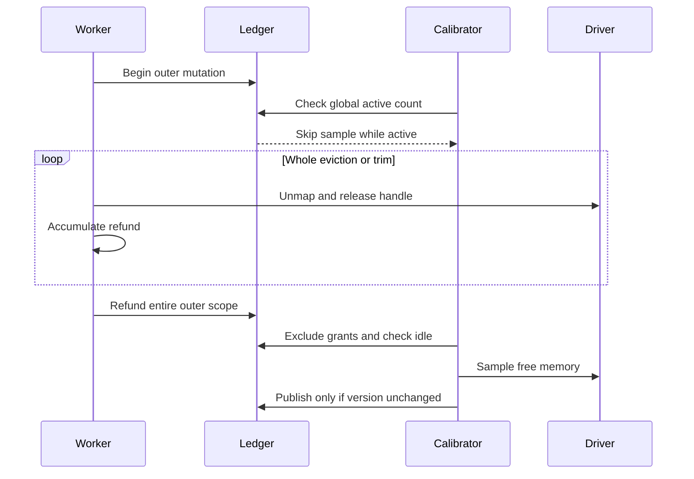
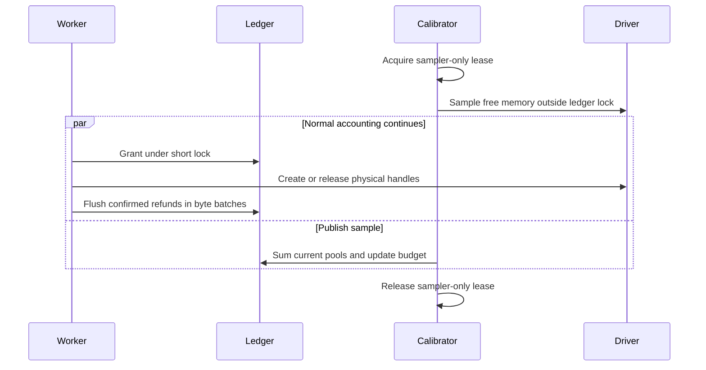

# Physical KV growth budget

The native allocator charges a shared per-GPU budget before creating a batch of
physical KV pages. CUDA allocation, mapping, IPC and rank waits do not hold the
accounting lock. Taking a block or page from the existing local reserve does not
acquire an additional budget lock or charge the same page again.

Batch grants serialize the GPU balance, owner charge and instance limit under
one short accounting lock. Existing local allocator synchronization remains.
This PR provides native growth accounting and resource lifecycle handling.
A narrow SGLang prefill guard reserves existing manager blocks before request
publication. Distributed admission and transaction integration remain separate work.
No minimum reservation, priority, reclaim policy or CPU offload is introduced.

## Accounting and identity

All participating workers on one GPU must share the same underlying file, not
merely matching pathnames in separate container mounts. In particular, private
container `/dev/shm` mounts do not coordinate; configure a shared mount when needed.
This revision changes the ledger layout, so all participating workers must
restart together. The existing `.budget-v2` pathname is retained: an incompatible
live layout fails instead of silently creating a second budget. The file uses
the PCI bus ID and `KVCACHED_PHYSICAL_GROWTH_LOCK_DIR` (default `/dev/shm`).
GPU partitions with the same PCI identity are not separate accounting domains
in this version.
Use a consistent `KVCACHED_IPC_NAME` across an instance's workers. Its fallback is
the existing process-group naming convention. Pool IDs remain separate records;
the instance limit applies to their sum on that GPU. Clean shutdown reclaims an
instance slot only after no owned or charged pool references it. A surviving pool
therefore retains its limit and revision across another participant's shutdown.

The ledger grants a whole native batch if both the GPU and instance budgets
permit it. Each allocation gets a receipt. Unused grant bytes are returned;
issued receipts are returned only after successful physical release and removal
of their mappings. Local reserve reuse and map commit do not charge again.
Startup zero-page backing and non-KV allocations are reflected in device samples
rather than tracked as dynamic KV growth receipts.

Partial map failure rolls back this transaction's newly attached pages and
preserves pre-existing adopted pages. Failed cleanup retains its owner for abort
retry. An uncertain VMM mapping remains charged and quarantined; worker restart
is required when its state cannot be recovered. Finalized map transaction IDs do
not provide a durable replay protocol; that remains part of distributed
integration. Duplicate operations on live transactions do not charge twice.

## Device-memory calibration

Initialization samples device free memory and subtracts the safety margin from
`KVCACHED_GPU_UTILIZATION`. This is a fixed safety margin for device usage, not
a per-priority reservation.

Physical growth and single-process admission queries refresh the estimate when
the last sample is at least one second old. An explicit
`recalibrate_physical_budget()` call can sample sooner. Sampling no longer needs
all participants idle. There is no shared active-mutation count or version test.

A nonblocking kernel lease serializes only calibrators, from the driver query
through publication. A second calibrator skips its sample while the lease is
held. Grants, refunds and owner retirement use only the short accounting lock
and do not wait for the sampler. A crashed calibrator releases its lease.

After sampling, the calibrator sums the current pool records under the short
lock and sets

```text
budget = max(0, current_charged_bytes + sampled_free_after_safety_margin)
```

The charge sum is read at publication, after any intervening retirement or
refund. This also preserves negative headroom before clamping. Instance limits
still apply to the sum of that instance's pools, independently of calibration.

### Error and release accounting

This budget is an estimate. An unmaterialized grant is charged but may still
appear in device free memory. A physically released page awaiting its refund
can also appear in both values. Either can leave excess credit after the grant
materializes or the refund completes. Device activity between the driver query
and publication adds another sampling error, and unrelated allocations can
consume memory after publication. The next successful sample updates the
estimate without waiting for all participants to stop.

Refund scopes now accumulate less than 64 MiB per releasing thread and budget
connection. Before another receipt would reach that threshold, the previous
batch is flushed under the accounting lock. A receipt of 64 MiB or more refunds
directly after successful physical release and confirmed unmapping. Nested
eviction, trim and destroy scopes share this bounded batch rather than holding
all their refunds until the outer operation ends. Outermost completion flushes
the remainder.

The batching threshold is not a global error bound. In healthy accounting,
each concurrent releasing thread can temporarily have its queued bytes plus
one just-released physical handle awaiting publication. A compound handle is
`page_size * num_layers * num_kv_buffers` and can itself exceed 64 MiB. Add all
concurrent unmaterialized grants across pools, sampler latency and external
memory changes. Five logical pages are neither a universal grant size nor a
global maximum. The native reservation API can request a larger batch.

Failed physical release or uncertain mappings do not refund. Failed refund
publication retains queued bytes and leaves the incoming receipt retryable.
The failed scope closes, so a later scope can drain that backlog without
permanent nesting. During accounting failures the healthy-path bound is
insufficient: retained receipts and unconfirmed cleanup may add further error.
The margin is a cushion, not a proof that grants or requests cannot OOM.

Registration retires a dead owner only after its kernel owner lease closes.
It subtracts the charge from both the budget (saturating at zero) and the pool
record under the short lock. Retirement therefore creates no spendable GPU
credit and does not assert that the driver has finished cleanup. A later sample
reflects memory actually observed free. Live owners retain their charges and
instance limits. A process dying in a grant or retirement no longer freezes
calibration for the remaining epoch.

### Scheduling and timing

Admission estimates do not reserve capacity. Worker-IPC estimates remain
driver-based because the ledger belongs to the workers. Native grants remain
authoritative against the current ledger and instance limit, while allocation
failures still need the existing rollback and engine refusal paths.

Previous calibration and release flow



Current calibration and release flow



Initialization still serializes joining connections through the first sample.
No CUDA or IPC work holds the data lock. All cases require one shared ledger
mount per GPU, including when workers run in separate containers.

## Native interfaces and validation

- `physical_budget_state(group_id=0)` returns GPU and instance charges, budgets,
  and process-local accounting synchronization counters.
- `set_instance_budget_limit(bytes, revision, group_id=0)` updates an instance's
  GPU limit and returns `applied`, `stale` or `conflict`. Shrinking below current
  usage blocks new growth without taking away existing pages.
- `recalibrate_physical_budget(group_id=0)` returns whether a sample was applied.

`tests/cpp/run_tests.sh` covers accounting, multi-process contention, calibration
races, process death, old epochs and file replacement without requiring a GPU.
`tests/test_vmm_transaction.py`, `tests/test_vmm_failure_policy.py` and
`tests/test_native_unmap_retry.py` exercise real VMM allocation/mapping/release,
injected failures, multi-pool limits and external CUDA allocation calibration.
These tests do not constitute a serving throughput benchmark or multi-GPU proof.

## Synchronization measurement

The `sync_*` fields in `physical_budget_state()` are process-local counters for
this budget connection. Acquisition time includes the synchronization primitive's
uncontended cost. Wait time starts after its first contended attempt; it excludes
the allocator's local mutex. Snapshot queries also acquire the accounting lock.
`sync_cas_retries` is zero for the flock backend.
`sync_dead_owner_recoveries` counts retired pool records, not confirmed CUDA frees.
These counters describe accounting synchronization, not end-to-end token latency.

Native pool registration uses the resolved Python IPC instance name, including
engine tags and collision suffixes. Direct dispatcher callers can pass an explicit
instance name; their fallback is process-local unless `KVCACHED_IPC_NAME` is set.
If ledger access fails during teardown, native unmap/release is still attempted,
but unconfirmed refunds remain charged to the old epoch.

## SGLang prefill failure boundary

For SGLang 0.5.20 single-rank page-size-one prefill, the adapter reserves physical
KV and Mamba blocks before `prepare_for_extend` allocates request rows. A failed
reservation releases unused reservations and returns unpublished requests
to the normal queue while preserving their original retraction flags and count.
An existing chunk retains its row, Mamba state and previous
inflight count. No allocation retry runs inside the failed call.

This guard excludes sessions, multi-rank/pipeline execution, speculative/dLLM,
hierarchical caches and other page sizes. It does not catch errors from the
original preparation function after publication begins. Native unsafe-state
errors remain fatal. It is not a general transactional scheduler or a guarantee
against unrelated CUDA OOM.
